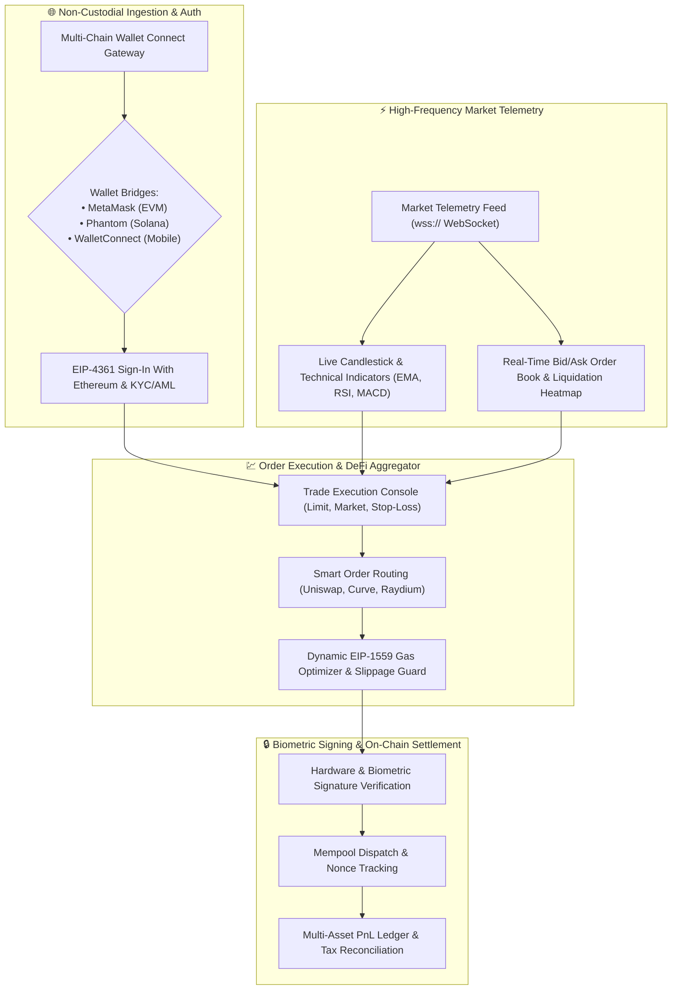
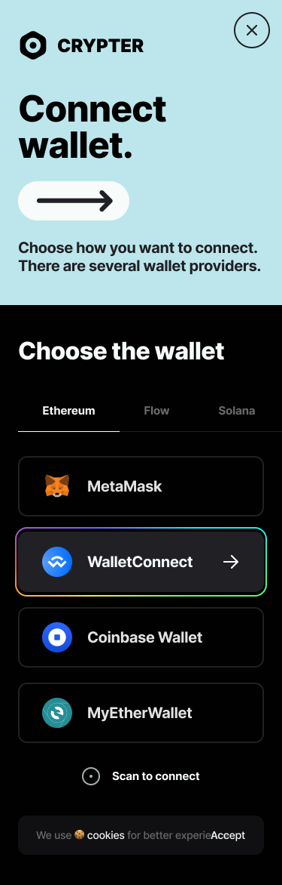

# ⚡ Apex Crypto — Next-Gen Web3 Exchange, DeFi & Multi-Chain Wallet Ecosystem

### **Comprehensive 380+ Screen UI/UX Design System, Multi-Chain Mobile Architecture & Real-Time Trading Terminal**

 

Designed by **[Obaidhur Rahaman](https://rahaman1721.framer.website)** · Full Stack Developer & UI/UX Designer  
*Bridging low-latency financial telemetry, institutional trading interfaces, and intuitive consumer Web3 on-ramps.*

---

## 📌 Executive Summary

**Apex Crypto** is an enterprise-scale cryptocurrency exchange, decentralized finance (DeFi) aggregator, and non-custodial multi-chain wallet platform. 

Crypto trading interfaces present steep cognitive barriers for retail users while failing to deliver the high-density analytical depth demanded by professional derivative traders. Apex Crypto addresses both segments through an exhaustive **380+ screen component-driven design system** spanning:

- **Seamless Web3 Onboarding**: Frictionless non-custodial wallet connections (MetaMask, Coinbase Wallet, WalletConnect, Phantom, Trust Wallet) and Fiat-to-Crypto rails.
- **Institutional Mobile Trading App**: Real-time candlestick charts, depth books, order execution sliders, stop-loss/take-profit triggers, and portfolio PnL telemetry.
- **Desktop Trading Terminal**: Multi-monitor responsive dashboard featuring order flow heatmaps, liquidity pools, cross-margin staking, and automated DCA bots.
- **DeFi Yield & Staking Vaults**: Transparent APY breakdowns, smart-contract audit verification badges, and automated gas estimation.

---

## 🏗️ System Architecture & Financial Telemetry Flow

Apex Crypto bridges non-custodial Web3 identity with **high-frequency market data pipelines**, ensuring millisecond execution while protecting users against frontrunning, MEV bots, and unexpected gas spikes.

### 🔬 Financial Architecture & Execution Safeguards

1. **Multi-Protocol Non-Custodial Bridging**:
   - The onboarding gateway harmonizes distinct cryptographic signatures (EVM ECDSA, Solana Ed25519) into a single unified UX layer, supporting hardware devices (Ledger, Trezor) alongside browser extensions.
2. **Sub-100ms Telemetry Rendering**:
   - Market data streams over persistent WebSocket channels directly into virtualized DOM lists and HTML5 canvas charts, maintaining 60fps rendering even during high-volatility market sell-offs.
3. **MEV & Slippage Protection Engine**:
   - The trade console dynamically calculates maximum tolerable price impact and routes swaps through decentralized liquidity aggregators, preventing front-running and sandwich attacks.

---

## 🖼️ High-Fidelity Design Artifacts & Production Canvases

### 1. Multi-Chain Wallet Connect & Web3 Provider Gateway
Unified modal interface supporting EVM, Solana, and Bitcoin Layer-2 protocols with QR code bridging, hardware wallet connections, and phishing protection warnings.

---

### 2. Comprehensive Mobile Trading & DeFi App Flow (375px Canvas)
Complete end-to-end user journeys spanning onboarding, biometric security setup, spot/perpetuals trading, live candlestick indicators, token swap interfaces, and DeFi staking vaults.

---

### 3. Institutional Desktop Terminal & Analytics Suite (1600px Canvas)
High-density trading terminal with customizable modular widgets, live order book depth chart, trade execution console, market news sentiment feed, and multi-asset margin calculators.

---

## 🧠 Financial UX & Risk Engineering Principles

| UX Challenge | Apex Solution & Safeguards |
|:---|:---|
| **Gas Volatility & Failed Transactions** | Real-time dynamic gas speed presets (Slow, Average, Fast) with clear fiat conversions, preventing unexpected out-of-gas failures. |
| **Fat-Finger Execution Risk** | 2-step slide-to-confirm triggers for market orders exceeding 10% of portfolio value, coupled with explicit slippage tolerance indicators. |
| **Seed Phrase Cognitive Overload** | Gamified interactive backup verification replacing stressful manual transcription with structured word-tile sequence confirmation. |
| **Information Density vs. Cognitive Load** | Progressive disclosure allows retail traders to toggle simplified "Lite Mode" or expand the full "Pro Terminal" layout. |

---

## 🎨 Design System & Color Psychology

- **Deep OLED Midnight (`#0A0B0E`, `#12141A`)**: Reduces eye fatigue during extended trading sessions and maximizes chart contrast.
- **Bullish Growth Green (`#00E676`)**: High-saturation emerald green for positive PnL, bid orders, and verified transactions.
- **Bearish Volatility Crimson (`#FF334B`)**: High-visibility alert red for ask orders, liquidation thresholds, and negative delta.
- **Solana / Ethereum Accents (`#8A2BE2`, `#627EEA`)**: Preserves native protocol brand recognition across multi-chain bridges.
- **Tabular Monospace Numerics**: JetBrains Mono / Inter Tabular figures ensuring zero horizontal jitter as asset prices fluctuate in real time.

---

## 📐 Scope & Deliverables

- **380+ Unique High-Fidelity Screens**: Covered across authentication, KYC/AML identity verification, wallet management, trading pairs (Spot, Futures, Perpetual Swaps), DeFi liquidity pools, NFT gallery, account settings, and transaction receipts.
- **Design Specifications**: Figma auto-layout components, 8pt spatial grid, dark/light theme tokens, and interactive micro-interaction specs.
- **Target Audience**: Retail Web3 users, institutional crypto asset managers, day traders, and DeFi liquidity providers.

---
---

## 👨‍💻 Author

**Obaidhur Rahaman**  
Full Stack Developer & Lead UI/UX Designer  

- 🌐 **Portfolio**: [https://rahaman1721.framer.website](https://rahaman1721.framer.website)  
- 🐙 **GitHub**: [@rahaman1721](https://github.com/rahaman1721)  
- 💼 **LinkedIn**: [linkedin.com/in/obaidhur-rahaman-1721z](https://www.linkedin.com/in/obaidhur-rahaman-1721z)  
- 📧 **Email**: [rahaman171920@gmail.com](mailto:rahaman171920@gmail.com)  

  Designed & Developed with precision by Obaidhur Rahaman © 2026

